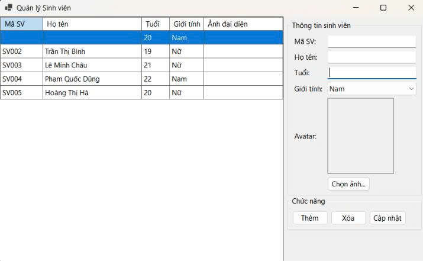
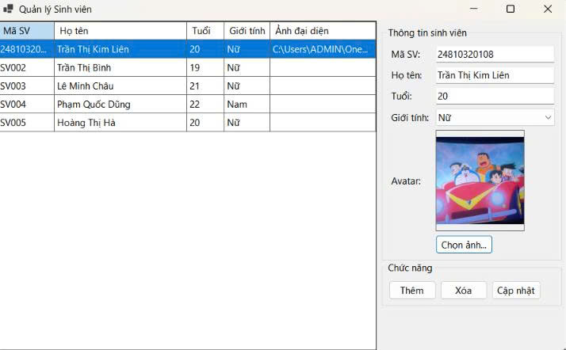
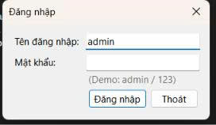
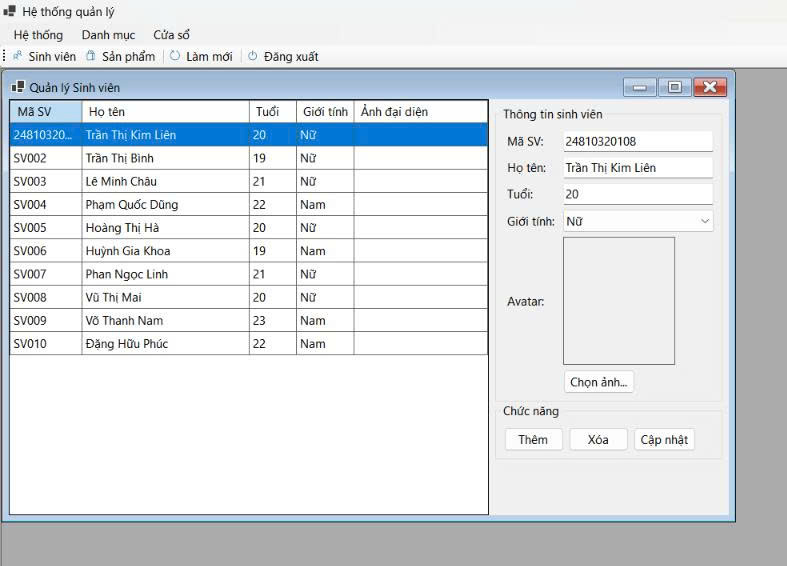
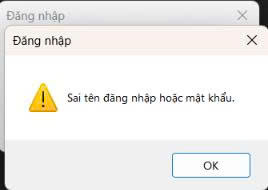
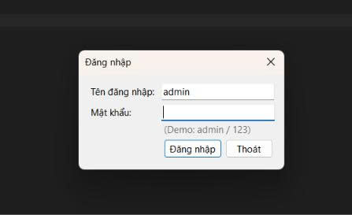
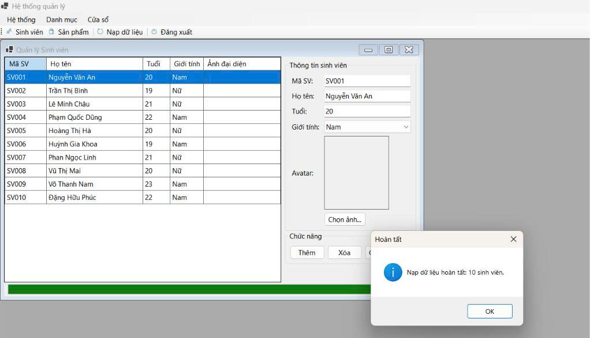
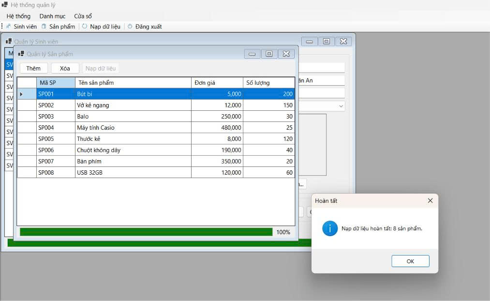

# BÁO CÁO BÀI TẬP / ĐỒ ÁN

## THÔNG TIN SINH VIÊN
- **Họ và tên:** Trần Thị Kim Liên
- **Mã số sinh viên:** 24810320108
- **Lớp:** D19QTANM1
- **Tên môn học:** Lập trình C# / Windows Forms
- **Tên bài tập:** BÀI 4.6-4.8

---

## KẾT QUẢ THỰC HÀNH

### Bài tập 4.6

#### 1. Ảnh màn hình Giao diện chính

#### 2. Ảnh màn hình Chức năng thực thi / Kết quả

### Bài tập 4.7

#### 1. Ảnh màn hình Giao diện chính

#### 2. Ảnh màn hình Chức năng thực thi / Kết quả

#### 3. Ảnh màn hình Kiểm tra lỗi (Validation)

### Bài tập 4.8

#### 1. Ảnh màn hình Giao diện chính

#### 2. Ảnh màn hình Chức năng thực thi / Kết quả

